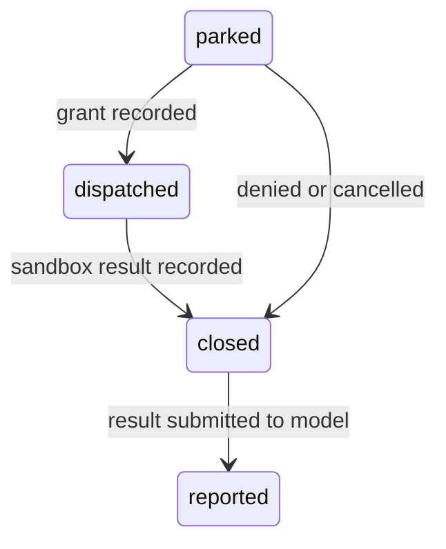

# crypto-research-tx-agent

A crypto research & trading agent built to run as a cloud worker. Sessions, runs, and tool calls
are durable through [`@earendil-works/pi-durable`](https://github.com/earendil-works/pi/tree/main/packages/durable),
stored in Postgres as rows in one shared schema: every session carries the tenant that owns it, and
one worker serves every tenant. A worker that dies mid-run is replaced by another: a read reruns, a
note write can safely run again, and an order dispatch is never attempted twice. If a worker stops
after dispatch begins, its result may be unknown; recovery records `interrupted` and does not retry.

## Status

Built, with a test for each claim:

- Durable sessions and runs on pi-durable 1.1.0 — Postgres (one shared schema) for cloud workers,
  SQLite or memory for local development.
- A command API — `start`, `reload`, `persist`, `resume`, `approve`, `cancel` — each naming its
  tenant, with idempotent starts that hold across crashes.
- Three research tools. `place-order` parks the order and ends the run; approval permits at most
  one dispatch attempt for that operation id.
- Crash recovery verified by killing real processes mid-tool: safe tools rerun, orders are reported
  `interrupted` and never resent, and a second worker takes the storage over.
- Row-level tenant isolation: one idempotency key per tenant, one thread directory per tenant, and
  an owner row that fails closed when another tenant names a session it does not own.
- pi-durable's own storage conformance suite (24 cases at 1.1.0) passing against Postgres.
- An AG-UI server on `POST /agent` and a page that drives it, tenant chosen per request.
- Bearer token authentication maps each request to its tenant through `TENANT_TOKENS`.

Not built yet — the seams exist, the implementations do not:

- A container or microVM sandbox. Today's tools execute no code, so a per-session directory is the
  boundary they need. Code or shell tools must get a container gateway behind the same
  `LeaseExecutor` seam before they ship.
- A real exchange and real market data: `read-market` and `place-order` return text from
  `packages/sandbox`.
- Per-tenant model keys. The worker resolves provider keys from the operator's
  `model_providers.json`; a tenant-scoped key store is not built.
- More than one worker per database. pi-durable's ids come from one sequence, so one worker owns
  the whole schema; scale by sharding tenants across databases.

## Architecture

| Package                    | Role                                                                  |
| -------------------------- | --------------------------------------------------------------------- |
| `@crypto/domain`           | Policy, no I/O: tool effect classes, leases, commands, session views. |
| `@crypto/sandbox`          | Executes one lease inside one session's workspace (`LeaseExecutor`).  |
| `@crypto/storage-postgres` | pi-durable storage on Postgres, plus the single-writer storage lock.  |
| `@crypto/agent`            | The commands, the research tools, the worker, and the AG-UI server.   |
| `@crypto/web`              | The page. It posts AG-UI runs to that server.                         |

How a run flows:

1. A command reaches `@crypto/agent`, which drives a pi-durable conversation: submissions in,
   transcript entries out, every commit landing in the shared storage.
2. The model calls a tool. The tool builds a lease from `@crypto/domain` policy — the effect class
   (`read`, `idempotent-write`, `external`) decides recovery — and executes it through the session's
   sandbox workspace in `@crypto/sandbox`.
3. `place-order` parks a durable order and ends the run without another model call. `approve` later
   records a dispatch attempt before calling the sandbox and reports its outcome back into the
   transcript. A worker crash after dispatch begins can leave the external outcome unknown.

Two boundaries from `docs/requirements_design.md` shape this: Pi does not isolate tool execution
(that boundary lives behind `LeaseExecutor`), and durable persistence does not guarantee exactly-once
external effects. The order state machine prevents a second dispatch attempt after an uncertain
result.

## Run it

Node 22.19+ (pi-durable's floor; developed on 24) and pnpm 12:

```bash
corepack prepare pnpm@12.11.2 --activate
pnpm install
pnpm typecheck   # tsc -b; also compiles the tests that pnpm test runs
pnpm test
pnpm lint        # oxlint
pnpm fmt         # oxfmt
```

`pnpm-workspace.yaml` denies install scripts for three transitive dependencies (`@google/genai`,
`esbuild`, `protobufjs`); without that the install stops on an interactive approve-builds prompt.

The Postgres tests read `CRYPTO_TEST_POSTGRES` (default `postgres:///crypto_research_test`) and
create and drop schemas in it. Point it only at a scratch database. Without a reachable server
those tests skip.

## Open the page

The page and the agent speak [AG-UI](https://github.com/ag-ui-protocol/ag-ui). The browser posts `RunAgentInput` to `POST /agent` and reads the SSE event stream. Every request carries a Bearer token configured in `TENANT_TOKENS`; the token determines the tenant. An optional `x-tenant-id` header must match that tenant. The page has fields for both values and keeps the token in page memory. The model id, an optional Horizon, and the extension choice (`crypto-research` or `code-execution`) travel in `forwardedProps`; the choice decides which extension's tools and system prompt the thread loads. A parked `place-order` ends the run as an interrupt; Grant sends `resume` with `payload.decision` `grant`, and Deny sends `deny`.

Fill `.env` from `.env.example` (`HTTP_HOST`, `HTTP_PORT`, `SCHEMA`, `SANDBOX_ROOT`, `TENANT_TOKENS`, `DEFAULT_MODEL`, `CATALOG_PATH`, `WEB_DIST`). Set `TENANT_TOKENS` to a JSON object mapping each tenant id to a unique token of at least 32 characters. Put provider keys in `model_providers.json` (see `model_providers.example.json`). `DEFAULT_MODEL` is `provider/modelId` and must exist in that file.

The server logs every request, authentication failure, agent command, and run outcome. The `LOG_*` entries in `.env.example` control it: `LOG_LEVEL` (`DEBUG`/`INFO`/`WARNING`/`ERROR`, default `INFO`), `LOG_FORMAT` (`text`, `json`, or `auto` — text on a terminal, JSON otherwise; the file always gets JSON lines), `LOG_CONSOLE_ENABLED`/`LOG_FILE_ENABLED`, `LOG_DIR` (the file is `agent.log`), `LOG_QUEUE_SIZE` (a full queue drops records and reports the count with the next write), and rotation by `LOG_FILE_MAX_BYTES` keeping `LOG_FILE_BACKUP_COUNT` numbered backups. An unusable `LOG_DIR` disables the file side with one console notice and the server keeps running; `DEBUG` and `INFO` go to stdout, `WARNING` and `ERROR` to stderr.

```bash
pnpm typecheck
pnpm --filter @crypto/web build
pnpm start
```

Open `http://127.0.0.1:8787`. During page work, `pnpm dev:web` proxies `/agent` and `/api` to that same port.

## Local development

```ts
import { createResearchAgent } from "@crypto/agent";
import { brand } from "@crypto/domain/lease";

const agent = await createResearchAgent({
  directory: "./dev", // SQLite session log + sandbox under this directory; omit for in-memory
  model: "openai/gpt-6-sol",
});
const result = await agent.execute({
  kind: "start",
  tenantId: brand("local", "TenantId"),
  idempotencyKey: "demo",
  input: "What changed in BTC funding?\nHorizon: 24h",
  extension: "crypto-research", // or "code-execution"; omit to load every installed extension
});
if (result.kind === "ok") {
  console.log(result.view.status, result.view.transcript);
}
await agent.close();
```

`createResearchAgent` reads model keys from the environment through pi-ai's built-in providers. Any
number of tenants can be named in its commands; the sessions live in the one SQLite or memory
storage.

## Cloud worker

```ts
import { openAgentWorker } from "@crypto/agent";
import { brand } from "@crypto/domain/lease";

const worker = await openAgentWorker({
  connectionString: process.env.DATABASE_URL, // one database, one schema for every tenant
  schema: "crypto_agent", // created when absent; [a-z][a-z0-9_]{0,62}
  sandboxRoot: "/var/lib/crypto-agent/sandboxes", // workspaces become session-<id>
  model: "openai/gpt-6-sol",
});

const started = await worker.execute({
  kind: "start",
  tenantId: brand("acme", "TenantId"),
  idempotencyKey: requestId,
  input: "What changed in BTC funding?\nHorizon: 24h",
  extension: "crypto-research",
});

await worker.close(); // releases the storage lock and the connections
```

Opening a storage another worker already holds throws `StorageBusy`. Omit `sandboxRoot` and the
notes live in memory only. A `start` may also carry `model: "provider/modelId"`; an id the catalog
does not know is rejected as `invalid-request` before anything runs, and the run keeps the model it
was started with across approvals and restarts.

### Isolation

| Layer       | Mechanism                                                                                                                                                                                                              |
| ----------- | ---------------------------------------------------------------------------------------------------------------------------------------------------------------------------------------------------------------------- |
| Sessions    | A `SessionOwnerDoc` row written in the same commit as the conversation. Every command checks it and fails closed: a session with no owner, or another tenant's name on it, is `session-not-found`.                     |
| Idempotency | Start keys are namespaced per tenant, so the same key in two tenants starts two sessions.                                                                                                                              |
| Threads     | `crypto_threads` keys on `(tenant_id, thread_id)`, so one tenant never reads or overwrites another's thread.                                                                                                           |
| Ownership   | A session advisory lock on the schema. A second worker gets `StorageBusy`.                                                                                                                                             |
| HTTP access | A Bearer token maps each request to a configured tenant; a supplied `x-tenant-id` must match.                                                                                                                          |
| Tools       | A workspace per session (`session-<id>` under `sandboxRoot`), minted by the agent, never by the model. Host-mode code execution is file separation only; docker mode adds process and network isolation per execution. |

**One worker per storage.** pi-durable has no cross-process locking; two writers on one schema mint
colliding ids (the storage-postgres tests demonstrate the collision). The advisory lock enforces
single ownership and dies with its connection, so a crashed worker's storage can be reopened
elsewhere without cleanup. That whole schema serves every tenant, so a single database cannot be
scaled past one worker with this backend; scale by sharding tenants across databases.

## The command API

Every command names its `tenantId` and returns `{ kind: "ok", view }` or
`{ kind: "rejected", rejection }`.

| Command             | Payload                                                                     | What it does                                                                                                                                                                                                                                                                                                                                                                         |
| ------------------- | --------------------------------------------------------------------------- | ------------------------------------------------------------------------------------------------------------------------------------------------------------------------------------------------------------------------------------------------------------------------------------------------------------------------------------------------------------------------------------ |
| `start`             | `tenantId`, `idempotencyKey`, `input`, `sessionId?`, `model?`, `extension?` | Submits a new run. Retrying the same key returns the session it created instead of running again — across a crash too. With `sessionId` the run continues that session's transcript; rejected `run-open` while its run is unfinished. `extension` names the extension the session loads (`crypto-research`, `code-execution`); omitted, the session loads every installed extension. |
| `reload`, `persist` | `tenantId`, `sessionId`                                                     | Return the current view. Every commit is durable once it resolves, so there is nothing left to flush.                                                                                                                                                                                                                                                                                |
| `resume`            | `tenantId`, `sessionId`                                                     | Finishes work a dead worker left: `replay: "safe"` tools rerun, an order left `dispatched` is reported `interrupted`, a closed-but-unreported order is reported.                                                                                                                                                                                                                     |
| `approve`           | `tenantId`, `sessionId`, `callId`, `operationId`, `decision`                | Decides a parked order. `deny` closes it without calling the sandbox; `grant` permits one dispatch attempt. `callId` and `operationId` must match the parked order.                                                                                                                                                                                                                  |
| `cancel`            | `tenantId`, `sessionId`                                                     | Aborts the run and closes its orders (`parked` -> cancelled, never sent; `dispatched` -> interrupted). Idempotent.                                                                                                                                                                                                                                                                   |

Rejections: `invalid-request`, `session-not-found`, `in-progress` (another command on this worker
is driving the session), `run-open`, `not-awaiting-approval`, `approval-mismatch`.

A view is `{ sessionId, head, status, transcript }`. The transcript holds `user`, `assistant`,
`tool-call`, and `tool-result` items; `head` counts the durable entries behind it and only grows.
A parked order's tool result only says it is waiting — its real result appears when the person
decides.

| Status              | Meaning                                                                                                                          |
| ------------------- | -------------------------------------------------------------------------------------------------------------------------------- |
| `empty`             | The session exists but has no run.                                                                                               |
| `running`           | A command on this worker is driving the run.                                                                                     |
| `awaiting-approval` | An order is parked; `callId` and `operationId` name it.                                                                          |
| `needs-resume`      | The run is open but nobody is driving it — a worker died mid-run, or an order finished without being reported. `resume` ends it. |
| `completed`         | Done; carries the last assistant text.                                                                                           |
| `cancelled`         | Cancelled. Terminal.                                                                                                             |
| `failed`            | The provider failed; carries the message. Terminal.                                                                              |

## Tools

| Tool          | Parameters                   | Effect class                | `replay`   | After a crash                                                       |
| ------------- | ---------------------------- | --------------------------- | ---------- | ------------------------------------------------------------------- |
| `read-market` | `symbol`                     | `read`                      | `"safe"`   | runs again                                                          |
| `write-note`  | `path`, `content`            | `idempotent-write` (sha256) | `"safe"`   | runs again; same hash returns stored text                           |
| `place-order` | `symbol`, `side`, `quantity` | `external`                  | `"unsafe"` | parks; one dispatch attempt after approval; uncertain after a crash |
| `run-bash`    | `command`                    | `compute`                   | `"safe"`   | runs again; same code returns the same output                       |
| `run-python`  | `code`                       | `compute`                   | `"safe"`   | runs again; same code returns the same output                       |

The operation id is minted by the agent as a durable memo inside the tool call, never taken from
the model, so a model cannot replay an earlier order by reusing its id.

## Code execution

`run-bash` and `run-python` build a `compute` lease and hand it to `createCodeSandbox`, which runs
the code outside the agent loop with a minimal environment — model credentials never reach it.
Output is capped at 64 KiB per stream. Two execution modes:

- **host** (default; dev and local): interpreters run as host child processes inside the session
  workspace, with `PATH` as the only environment variable.
- **docker** (production): each execution is a one-shot container (`--rm`) with the session
  workspace mounted at `/workspace`, no network (`--network none`), no capabilities
  (`--cap-drop ALL`, `no-new-privileges`), and memory / CPU caps. Aborting or timing out kills the
  container with `docker kill`; containers carry the label `crypto.sandbox=true` so stray ones can
  be found with `docker ps -a --filter label=crypto.sandbox=true`.

The server picks the mode from the environment: `CODE_SANDBOX_MODE` (`host`, the default, or
`docker`), `CODE_SANDBOX_IMAGE` (required for docker — pre-pull it, because the 30 s lease window
does not wait for a pull; the image must provide `bash`, `python3`, and `node` for the matching
tools), `CODE_SANDBOX_MEMORY` (default `512m`), `CODE_SANDBOX_CPUS` (default `1`).

Docker integration tests need a running daemon and run with `CRYPTO_DOCKER_TESTS=1`
(`CRYPTO_DOCKER_IMAGE` overrides the image).

## Order dispatch and recovery



- `place-order` parks an `OrderDoc` (`parked`) in the same commit as the transcript entry, then
  ends the run with `control: { terminate: true }` — no further model call until the decision.
- `approve` moves the order `parked -> dispatched` in one guarded commit **before** the sandbox is
  called. Only one grant can win, and a second `approve` is rejected.
- A worker can stop after recording `dispatched` and before recording the sandbox result. Recovery
  reports `interrupted`: the order may have been sent, and it will not be sent again. This gives at
  most one dispatch attempt; it does not guarantee that an external exchange completed the order.
- The decision continues the run as a submission idempotent by request id (`order:<operationId>`),
  so a crash between closing and reporting cannot report twice.
- Approvals survive restarts: park in one process and grant in another. Tests verify at most one
  dispatch attempt against SQLite and Postgres with a second worker taking over.
- No exchange or market data provider is configured. The default sandbox returns an explicit
  configuration error for `read-market` and `place-order`.

## The Postgres storage backend

pi-durable ships SQLite, JSONL, and memory backends. `@crypto/storage-postgres` reuses its portable
SQLite core behind the small `SqliteDatabase` facade instead of forking it, and translates the
dialect:

- `INTEGER` -> `BIGINT` (minted ids reach `Number.MAX_SAFE_INTEGER`), with node-pg's `int8` parsed
  back to numbers.
- SQLite-only `STRICT` tables and `CHECK (json_valid(...))` constraints are dropped.
- `INSERT OR IGNORE INTO` -> `ON CONFLICT DO NOTHING`.
- `?` -> `$1..$n`, numbered per statement.
- `ORDER BY created_at DESC` gains an `, id ASC` tie-break, matching SQLite's rowid order so the
  same document incarnation is always decoded.
- JSON columns stay `TEXT`: the core calls `JSON.parse` on what it reads.

One connection per storage, deliberately: the schema's `search_path` and advisory lock live on that
connection, and a Postgres transaction is bound to the connection that opened it, so transactions
are queued rather than overlapped.

The translation depends on pi-durable's SQL text. The guards, all run in `pnpm test`:

- pi-durable's own storage conformance suite runs against Postgres.
- The dialect tests assert against the migrations the installed package actually ships
  (`SQLITE_MIGRATIONS`) — including that no string literal contains a `?`, and that the core
  carries no DDL of its own — so an upgrade that changes the SQL fails in the suite, not in
  production.
- pi-durable is pinned to exactly `1.1.0`; it is marked Experimental. Upgrade only with the
  conformance suite green.

The package also exports the pieces directly: `openPostgresStorage`, `PostgresDatabase`,
`validateSchemaName` (the boundary that keeps a raw name away from `CREATE SCHEMA`), `ensureSchema`,
`tryTakeStorageLock` / `releaseStorageLock`, and `toPostgres`.

## Testing

| Suite                       | What it verifies                                                                                                                                                                                                                                                                                                                                                                                                                                                                                                                                                                                                                                                                                                                                                                                                                                                                                                                                                                                        |
| --------------------------- | ------------------------------------------------------------------------------------------------------------------------------------------------------------------------------------------------------------------------------------------------------------------------------------------------------------------------------------------------------------------------------------------------------------------------------------------------------------------------------------------------------------------------------------------------------------------------------------------------------------------------------------------------------------------------------------------------------------------------------------------------------------------------------------------------------------------------------------------------------------------------------------------------------------------------------------------------------------------------------------------------------- |
| `packages/domain`           | Effect classes, content-hash integrity, lease deadlines, tenant-id safety.                                                                                                                                                                                                                                                                                                                                                                                                                                                                                                                                                                                                                                                                                                                                                                                                                                                                                                                              |
| `packages/sandbox`          | Content-hash idempotency; two workspaces keep their notes apart. The code sandbox: host-mode stdout/exit/abort/timeout semantics; docker mode (gated by `CRYPTO_DOCKER_TESTS=1`) runs in a container, keeps workspace files across executions, has no network, and leaves no container behind after an abort.                                                                                                                                                                                                                                                                                                                                                                                                                                                                                                                                                                                                                                                                                           |
| `packages/storage-postgres` | The conformance suite above; every dialect rule against the shipped migrations; lock mutual exclusion; the lock released by the server when a connection dies; two unlocked writers on one schema collide — the hazard the lock exists to prevent.                                                                                                                                                                                                                                                                                                                                                                                                                                                                                                                                                                                                                                                                                                                                                      |
| `packages/agent`            | Commands end to end: idempotent start (same key, same session, one run), empty input rejected, reads through the sandbox, approval grant/deny/mismatch, active order cancellation and close recovery, provider errors fail the run, follow-up runs see the earlier transcript, sessions survive a new process. Extension selection: an unknown name is rejected, a thread loads the chosen extension's tools, a later start can switch it, and no choice loads every installed extension. Crash tests kill a real child process mid-tool on both SQLite and Postgres. Two tenants in one agent and in one Postgres worker keep separate sessions and idempotency keys, and a cross-tenant reload is `session-not-found`; `StorageBusy`; takeover after a dead worker; per-run model choices rejected before anything runs; the HTTP layer requires a Bearer token, forwards the extension choice, and scopes threads per tenant; the logger's level filtering, formats, queue drops, and file rotation. |

Tests run from compiled output — `pnpm typecheck` builds what `pnpm test` runs. The crash tests
spawn a child that dies inside the sandbox (`exit 9`), then reopen the storage the way a
replacement worker would.

## Layout

```text
packages/
  domain/             effect classes, leases, commands, session views — policy, no I/O
  sandbox/            the LeaseExecutor: one workspace store per session; code.ts runs compute leases
  storage-postgres/   dialect.ts, database.ts, the storage lock, the conformance suite
  agent/
    agent.ts          the commands, run and order state, transcript derivation
    research.ts       the crypto-research tools and the durable docs (session-owner, start, run, order, open-orders)
    extensions/       the code-execution extension (run-bash, run-python)
    worker.ts         openAgentWorker: schema, storage lock, sandbox, agent
    open.ts           openAgent: harness, registry, model resolution
docs/                 the research notes this build follows
```

## Further reading

- `docs/requirements_design.md` — the Pi research behind this design: what Pi provides, cloud
  deployment routes, and the boundaries encoded here (tool execution isolation and external effects
  need application-level handling).
- `docs/技术栈推荐：围绕 AI 反馈闭环做选型.md` — the toolchain choice: pnpm, TypeScript 7,
  oxlint/oxfmt, `node --test`.
