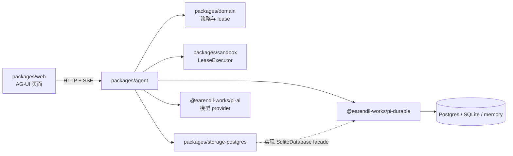
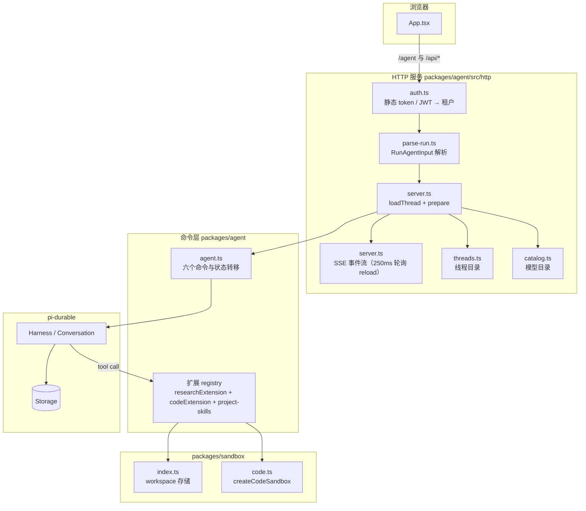
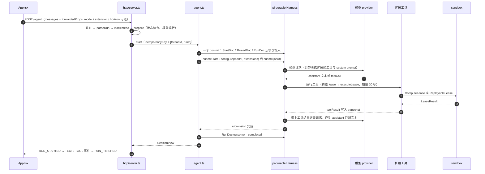
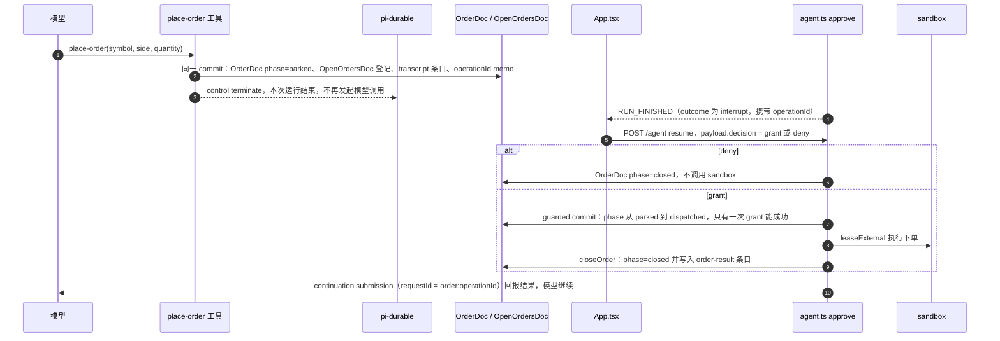
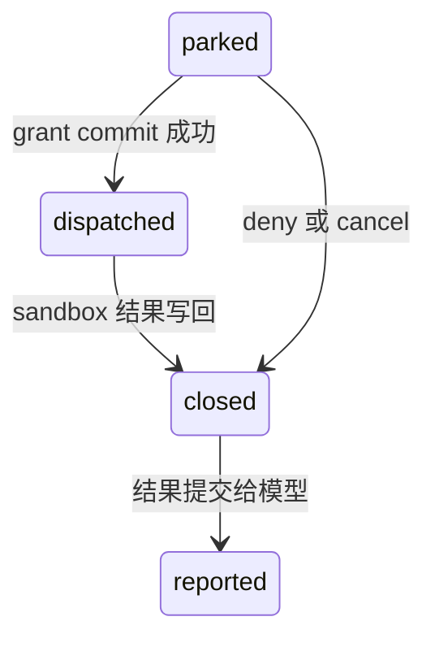
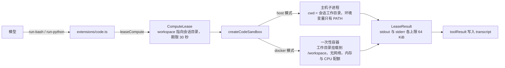
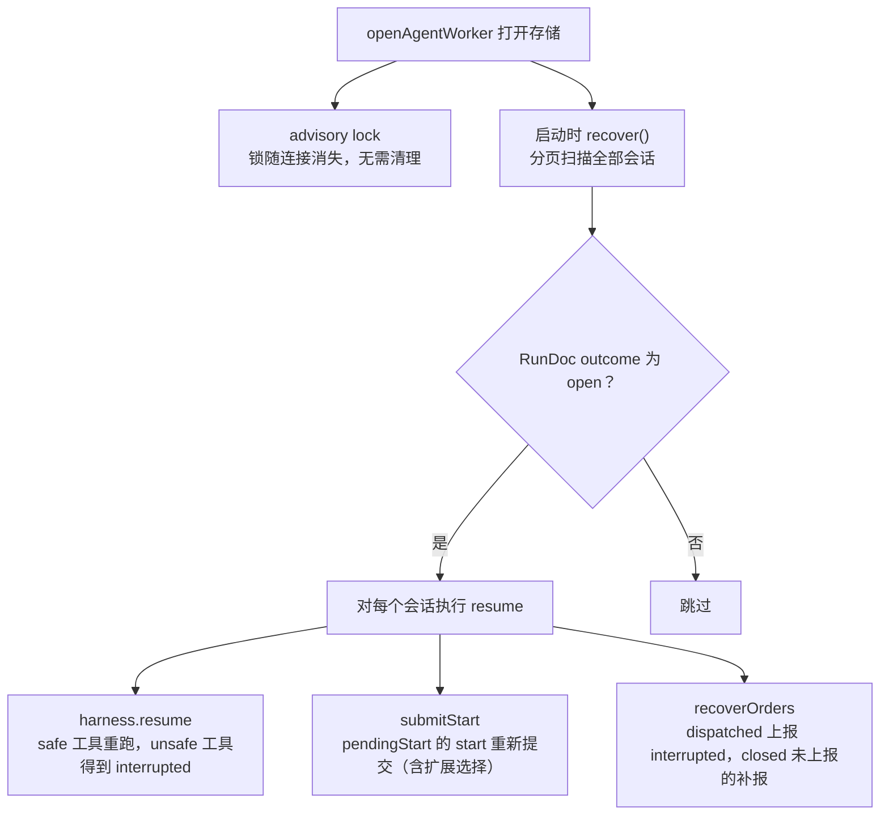

# 项目架构

通用 agent 服务。每个会话（session）是一个 pi-durable Conversation，全部状态写入 Postgres
的一个共享 schema，一个 worker 服务全部租户。crypto 调研与代码执行是两个扩展，前端按线程
选择加载哪一个；工具执行通过 lease 进入 sandbox；外部效应（下单）经过持久审批状态机，
一次审批至多派发一次。

## 模块总览

| 模块                        | 关键文件                    | 职责                                                                                                                                                                                                                                                                  |
| --------------------------- | --------------------------- | --------------------------------------------------------------------------------------------------------------------------------------------------------------------------------------------------------------------------------------------------------------------- |
| `packages/domain`           | `lease.ts`、`internal.ts`   | 策略层，无 I/O。EffectClass（`read` / `idempotent-write` / `external` / `compute`）、Lease 类型族与构造函数、`AgentCommand`、`SessionView`、`executeLease` 的期限与取消语义                                                                                           |
| `packages/sandbox`          | `index.ts`、`code.ts`       | LeaseExecutor 的实现。`index.ts` 提供 Firecrawl 网页搜索与 Markdown 页面读取，以及会话 workspace 的内容寻址存储（`write-note`）；`code.ts` 是代码执行 gateway（主机子进程 / docker 容器） |
| `packages/storage-postgres` | `database.ts`、`dialect.ts` | 把 pi-durable 的 `SqliteDatabase` facade 翻译到 Postgres（占位符、类型、`ON CONFLICT`），负责 schema 迁移与单写者 advisory lock                                                                                                                                       |
| `packages/agent`            | `agent.ts`                  | 命令层：`start` / `reload` / `persist` / `resume` / `approve` / `cancel` 的全部状态转移，run 与 order 的持久状态，transcript 推导                                                                                                                                     |
|                             | `research.ts`               | crypto-research 扩展（`web-search` / `read-webpage` / `read-market` / `write-note` / `place-order`）与全部 durable doc 定义                                                                                                                          |
|                             | `extensions/code.ts`        | code-execution 扩展（`run-bash` / `run-python`），构造 `compute` lease 交给 `createCodeSandbox`                                                                                                                                                                       |
|                             | `skills.ts`                 | 扫描项目技能目录并提供 `list-skills` / `read-skill` 工具                                                                                                                                                                                                              |
|                             | `worker.ts`、`open.ts`      | `openAgentWorker`（连接、锁、schema、扩展安装）与 `openAgent`（Harness、registry、模型解析、启动恢复）                                                                                                                                                                |
|                             | `http/*`                    | Hono 服务：认证（`auth.ts`，静态 token + JWT）、注册与用户目录（`users.ts`，scrypt 密码散列）、AG-UI 输入解析（`parse-run.ts`）、SSE 事件流（`server.ts`、`events.ts`）、线程目录（`threads.ts`）、模型目录（`catalog.ts`）、配置（`config.ts`）、日志（`logger.ts`） |
| `packages/web`              | `App.tsx`                   | React 页面：AG-UI 客户端，发送运行、轮询状态、展示审批按钮                                                                                                                                                                                                            |

## 运行形态

- **本地开发 / 测试**：`createResearchAgent({ directory, model })`。directory 存在时会话写入
  其下的 SQLite 文件，sandbox 工作目录在其 `sandbox/` 下；缺省则全部在内存。模型 key 从
  环境变量经 pi-ai 内置 provider 解析。
- **云端 worker**：`openAgentWorker({ connectionString, schema, sandboxRoot, model })`。连接
  Postgres，schema 缺失则创建，取得该 schema 的 advisory lock（第二个 worker 得到
  `StorageBusy`），在 `sandboxRoot` 下为每个会话创建 `session-<id>` 工作目录。
- **HTTP 服务**：`packages/agent/src/http/main.ts`。读取 `.env` 与 `model_providers.json`，
  装配 logger、线程目录（`memoryThreads` 或 `postgresThreads`，后者使用 `crypto_threads`
  表）、用户目录（`postgresUsers`，`crypto_users` 表）、`openAgentWorker` 与 Hono 路由，
  `WEB_DIST` 存在时同时服务编译后的页面。

## 调用关系

命令层内部：

- `start` 在一个 commit 里完成幂等 key 认领（`StartDoc`）、线程映射（`ThreadDoc`）、会话
  创建与归属（`SessionOwnerDoc`），然后 `submitStart` 应用模型与扩展选择
  （`conversation.configure`）并提交输入。
- `reload` / `persist` 读取视图；每笔 commit 完成即持久，没有待刷写的内容。
- `resume` 处理无人驱动的运行；`approve` 决定已停放的订单；`cancel` 中止运行并关闭订单。
- 线程映射的写入路径是 pi-durable 的 `ThreadDoc`（key 形如 `t:<tenant>:<threadId>` →
  conversationId）；HTTP 层的 `TenantThreads` 目录（`crypto_threads` 表）在 durable 层
  不认识该线程时作为按 sessionId 读取的补充路径。

### 登录与注册

- `POST /api/auth/register`：邮箱 + 密码。密码以 scrypt 加盐散列存入 `crypto_users`，
  邮箱为主键；注册成功铸造租户 id（`u_` + 24 位十六进制），邮箱已注册返回 409。
- `POST /api/auth/login`：校验邮箱与散列密码，成功后用 `AUTH_JWT_SECRET` 签发 HS256
  JWT（sub 为租户 id，有效期 `AUTH_JWT_TTL_SECONDS`，默认 24 小时）。
- 其余 `/api/*` 与 `/agent`：先查 `TENANT_TOKENS` 静态表（运维与本地开发），再校验
  JWT（注册用户登录所得）；`x-tenant-id` 一旦提供必须与最终命中的租户一致。
- 前端：登录 / 注册 / 访问令牌三种模式。会话（token 与租户 id）保存在 localStorage 的
  `crypto-session`；任意已认证请求收到 401 即清除会话并回到登录页。

## 数据流

### 新会话的一次运行

SSE 流期间 server 每 250 毫秒 `reload` 一次会话，把新增的 transcript 条目映射为 AG-UI 事件
（`events.ts` 的 `eventsForNewItems`）；连接断开时中止驱动，会话留在存储中等待恢复。

### 订单审批

审批跨进程成立：停放在一个进程、批准发生在另一个进程。派发开始后 worker 停止时结果
未知，恢复只上报 `interrupted`，绝不重试。

### 代码执行

模型凭证不进入任何一种执行环境：host 模式只传 `PATH`；docker 模式只传 docker CLI 需要的
`PATH`、`HOME`、`DOCKER_HOST`、`DOCKER_CONTEXT`。docker 模式的容器带 `crypto.sandbox=true`
标签，中止或超时会补一次 `docker kill`，防止客户端进程结束后容器继续运行。

### 崩溃恢复

worker 在运行中崩溃后，新的 worker 接管同一存储：

HTTP 请求路径上同样有恢复入口：`prepare` 看到会话状态为 `needs-resume` 时，先对该会话
执行 `resume` 命令再处理本次请求。

### 前端

- 发送：`run()` 向 `POST /agent` 提交 `RunAgentInput`，`forwardedProps` 携带模型 id、扩展
  选择、可选 Horizon；页面通过 SSE 事件流实时渲染消息与工具调用。
- 会话列表：`GET /api/threads` 返回本租户的全部线程（threadId、首问预览、运行状态），
  数据源是扫描 durable 的 `ThreadDoc`（key 前缀 `t:<tenant>:`）。点击列表项切换当前线程，
  由 `GET /api/threads/:threadId` 加载完整历史；"新建会话"生成新的 threadId，首次提问后
  进入列表。
- 会话读取：进入会话及 SSE 结束后读取 `SessionView`；后台仍在运行时每 1500 毫秒读取，
  完成、取消、等待审批或等待恢复后停止轮询。
- 审批：Grant / Deny 按钮发送带 `payload.decision` 的 resume 请求。
- 恢复与取消：`POST /api/threads/:threadId/resume` 与 `/cancel`。
- 本地保存：线程 id 存 `crypto-thread:<tenant>`，扩展选择存 `crypto-extension:<tenant>`，
  登录会话存 `crypto-session`；模型列表来自 `GET /api/models`（含默认模型）。

## 持久化数据

| 数据                         | 位置                                       | 内容                                                                  |
| ---------------------------- | ------------------------------------------ | --------------------------------------------------------------------- |
| pi-durable 核心行            | 共享 schema                                | 会话、entry 日志（transcript、submission、task checkpoint）、doc 存储 |
| `SessionOwnerDoc`            | doc，key 为 conversationId                 | 会话归属的租户，与创建会话的 commit 同笔写入                          |
| `StartDoc`                   | doc，key 为 `t:<tenant>:<idempotencyKey>`  | 幂等 start 的认领：输入、模型、扩展选择、submissionId                 |
| `ThreadDoc`                  | doc，key 为 `t:<tenant>:<threadId>`        | 线程到会话的映射，附带首问预览（前 120 个字符）                       |
| `RunDoc`                     | doc，key 为 `crypto.run:<sessionId>`       | 运行状态：outcome、submissionId、pendingStart、模型                   |
| `OrderDoc` / `OpenOrdersDoc` | doc                                        | 订单的 phase 状态机与活跃订单索引                                     |
| `crypto_threads`             | Postgres 表，`(tenant_id, thread_id)` 主键 | 线程目录的补充查询路径                                                |
| `crypto_users`               | Postgres 表，email 主键，tenant_id 唯一    | 注册用户的 scrypt 密码散列与租户 id，密码原文从不入库                 |
| 会话笔记                     | `<sandboxRoot>/session-<id>.json`          | `write-note` 的内容寻址存储（sha256）                                 |
| 代码工作目录                 | `<sandboxRoot>/session-<id>/`              | 代码执行的工作目录，跨多次执行保留                                    |
| 日志                         | `LOG_DIR/agent.log`                        | 请求、认证失败、agent 命令、运行结果的 JSON 行                        |

## 环境变量

`FIRECRAWL_API_KEY` 由 HTTP 服务读取并传给 sandbox。`web-search` 调用 Firecrawl Search 并附带
Markdown 页面内容，`read-webpage` 调用 Firecrawl Scrape。两种调用都建立 `read` lease，能够在
恢复时重新执行；SDK 抛出的请求错误会结束当前工具调用。

`SKILLS_ROOT` 默认为 `./skills`。服务启动时扫描其直接子目录，包含 `SKILL.md` 的目录通过
`list-skills` 和 `read-skill` 提供给每个会话；指定 `crypto-research` 或 `code-execution` 时项目
技能扩展仍然保留。

| 变量                                                               | 作用                                                          |
| ------------------------------------------------------------------ | ------------------------------------------------------------- |
| `HTTP_HOST` / `HTTP_PORT`                                          | 服务监听地址                                                  |
| `DB_HOST` / `DB_PORT` / `DB_USER` / `DB_PASSWORD` / `DB_NAME`      | Postgres 连接                                                 |
| `SCHEMA`                                                           | 全部租户共用的 schema，默认 `crypto_agent`                    |
| `SANDBOX_ROOT`                                                     | 会话工作目录与笔记的根目录                                    |
| `SKILLS_ROOT`                                                      | 项目技能目录，默认 `./skills`                                 |
| `CODE_SANDBOX_MODE`                                                | 代码执行方式：`host`（默认）或 `docker`                       |
| `CODE_SANDBOX_IMAGE` / `CODE_SANDBOX_MEMORY` / `CODE_SANDBOX_CPUS` | docker 模式的镜像与配额；镜像需预先 pull                      |
| `DEFAULT_MODEL` / `CATALOG_PATH`                                   | 默认模型 id 与 `model_providers.json` 路径                    |
| `FIRECRAWL_API_KEY`                                                | Firecrawl 网页搜索和 Markdown 页面读取的 API key              |
| `TENANT_TOKENS`                                                    | JSON，租户 id 到 Bearer token 的映射                          |
| `AUTH_JWT_SECRET` / `AUTH_JWT_TTL_SECONDS`                         | 登录 JWT 的签名密钥（至少 32 字符）与有效期（秒，默认 86400） |
| `WEB_DIST`                                                         | 编译后页面的目录，存在则由服务直接提供                        |
| `LOG_LEVEL` / `LOG_FORMAT` / `LOG_DIR` 等                          | 日志级别、格式、目录、轮转                                    |
